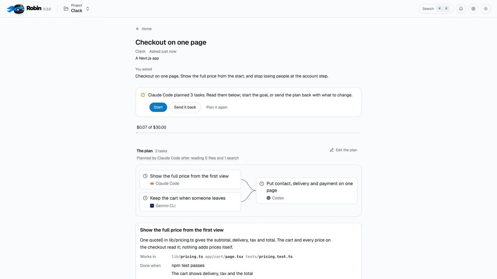

# Robin

Stop babysitting your coding agents. [getrobin.dev](https://getrobin.dev)

<picture>
  <source media="(prefers-color-scheme: dark)" srcset="docs/plan-dark.webp">
  
</picture>

Robin is a desktop app, with a phone app, that runs the coding agents you already use on your own computer: Claude Code, Codex, Gemini CLI, Cursor, OpenCode, Qwen Code, Goose, GitHub Copilot CLI, Factory Droid, Amp, Cline and Aider. Say what you want built in one sentence. Robin plans it, builds each task with an agent in its own copy of your project, side by side, and hands it back only once your checks, a design jury and a reviewer have passed it. Free in beta.

## Download

| System | Installer |
| --- | --- |
| **Windows** 10 and 11 | [Robin-Setup.exe](https://github.com/fadhelcarlos/robin-desktop/releases/latest/download/Robin-Setup.exe) |
| **macOS** 12 or later, Apple silicon | [Robin-Setup-arm64.dmg](https://github.com/fadhelcarlos/robin-desktop/releases/latest/download/Robin-Setup-arm64.dmg) |
| **macOS** 12 or later, Intel | [Robin-Setup-x64.dmg](https://github.com/fadhelcarlos/robin-desktop/releases/latest/download/Robin-Setup-x64.dmg) |

The installers aren't code-signed yet. On Windows, choose **More info**, then **Run anyway**. On a Mac, open **System Settings**, **Privacy & Security**, and choose **Open Anyway**.

## What it does

- **One sentence in, finished work out.** Say what to build, or send a GitHub or Linear issue. Robin plans it into tasks, each with what done means, and builds them side by side, each with its own agent in its own git worktree.
- **Checked, judged, reviewed.** Your own checks decide when a task is done. Every screen it touches is photographed in light and in dark and judged by a design jury of four; an agent from another vendor reviews every change. A finding goes back to its builder, never to you.
- **Only what is yours reaches you.** What an arbiter can rule in your place is ruled, and shown under Decided for you. What only you can answer reaches you at your desk or on your phone.
- **The factory.** Every project's goals on one page: what needs you, what is being built, what was delivered. A project built for someone gets its report, ready to send.
- **The Design studio.** New screens are drawn in several directions before they are built; compare rounds side by side, read a screen through lenses, draw a note on it.
- **It remembers.** A brief of your project, kept current from the code, and what earlier agents learned go into every session, from every agent, through its hooks and MCP.
- **Yours.** Robin runs on your machine with your agents' own accounts. No Robin account, no telemetry. The phone pairs to your computer over your own Tailscale network.

## Requirements

- Windows 10 or 11 (x64), or macOS 12 or later
- At least one supported coding agent, installed and signed in
- [Tailscale](https://tailscale.com), only for the phone

## About this repository

It hosts Robin's installers and the feed the app updates from. Robin is proprietary and its source isn't published; the app is free to use under the Robin Terms that come with it.

Questions, or something that doesn't work: [info@getrobin.dev](mailto:info@getrobin.dev).

Built by [Carlos Fadhel](https://checkboxlabs.my/carlosfadhel).
