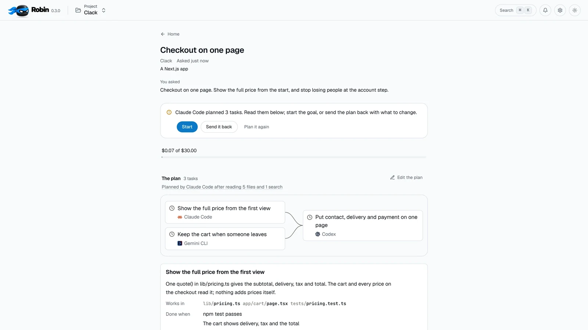
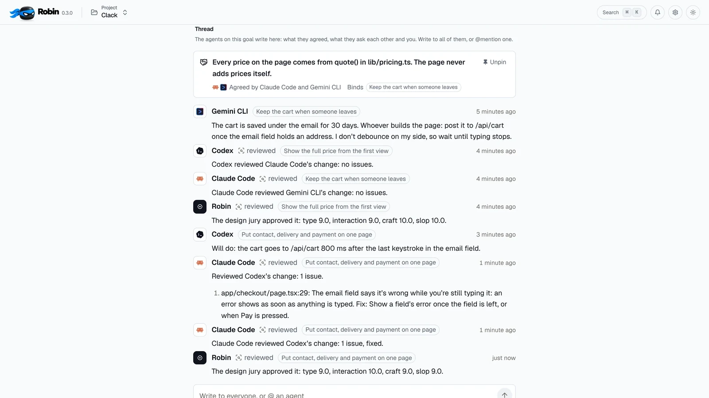
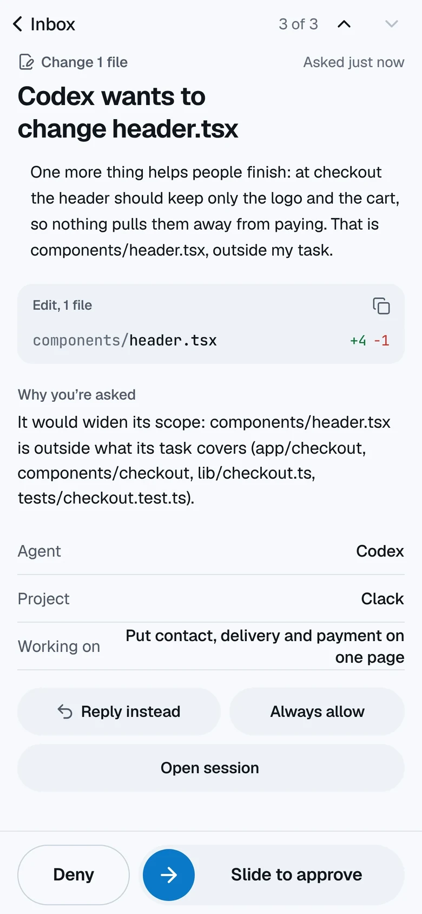

# Robin

Your coding agents, working as one team. [getrobin.dev](https://getrobin.dev)

<picture>
  <source media="(prefers-color-scheme: dark)" srcset="docs/plan-dark.webp">
  
</picture>

Robin is a desktop app, with a phone companion, that runs the coding agents you already use as one team on your own computer: Claude Code, Codex, Gemini CLI, Cursor, OpenCode, Qwen Code, Goose, GitHub Copilot CLI, Factory Droid, Amp, Cline and Aider. Say what to build. An agent plans it into tasks, and nothing runs until you press Start. Each task works in its own branch with the agent that fits it, an agent from another vendor reviews every change, your checks decide when it's done, and only the decisions that are yours reach you, at your desk or on your phone.

## Download

| System | Installer |
| --- | --- |
| **Windows** 10 and 11 | [Robin-Setup.exe](https://github.com/fadhelcarlos/robin-desktop/releases/latest/download/Robin-Setup.exe) |
| **macOS** 12 or later, Apple silicon | [Robin-Setup-arm64.dmg](https://github.com/fadhelcarlos/robin-desktop/releases/latest/download/Robin-Setup-arm64.dmg) |
| **macOS** 12 or later, Intel | [Robin-Setup-x64.dmg](https://github.com/fadhelcarlos/robin-desktop/releases/latest/download/Robin-Setup-x64.dmg) |
| **Linux** x64 | [Robin.AppImage](https://github.com/fadhelcarlos/robin-desktop/releases/latest/download/Robin.AppImage) or [robin_amd64.deb](https://github.com/fadhelcarlos/robin-desktop/releases/latest/download/robin_amd64.deb) |

Every version is in [the releases](https://github.com/fadhelcarlos/robin-desktop/releases). Robin updates itself from inside the app, and an install from before the rename moves over by itself, settings and history included.

The installers aren't signed yet. On Windows, choose **More info**, then **Run anyway**. On a Mac, open **System Settings**, **Privacy & Security**, and choose **Open Anyway**.

## What it does

- **Plan first.** Type a goal, or send a GitHub or Linear issue. An agent reads the code and splits the work into tasks, each with its files, its steps, its agent and what done means. You can edit the plan, and nothing runs until you press Start.
- **One team, many vendors.** Every task works in its own git worktree, side by side. The agents agree on how their pieces fit in the goal's thread, and an agreement, once pinned, holds every task it touches.
- **Reviewed by another vendor.** Claude Code reviews Codex's change, Codex reviews Gemini CLI's. A finding goes back to the agent that wrote the change before it ever reaches you.
- **Checks decide done.** Your own scripts are the gate. A failure goes back to the agent with what failed, and if an agent stops, at a usage limit or an error, another one continues in the same checkout with a handoff.
- **Only real decisions reach you.** Inside its own branch an agent never waits on you. When something is yours to decide, it asks with the options and what each one means, and you answer at your desk or slide to approve on your phone.
- **It remembers.** A brief of your project, written from the code and kept current, what earlier agents learned and the agreements in force go into every session, from every agent, through its hooks and MCP.
- **Real terminals.** Any agent you start yourself runs in a native terminal inside Robin, tied to its goal and its task. It outlives the window, never stalls the app, and answers from your phone.
- **Yours.** Robin runs on your machine with your agents' own accounts. No Robin account, no telemetry. The phone pairs to your computer over your own Tailscale network, never the public internet.

  <picture>
    <source media="(prefers-color-scheme: dark)" srcset="docs/thread-dark.webp">
    
  </picture>
  &nbsp;
  <picture>
    <source media="(prefers-color-scheme: dark)" srcset="docs/phone-approve-dark.webp">
    
  </picture>

## Requirements

- Windows 10 or 11 (x64), macOS 12 or later, or Linux (x64)
- At least one supported coding agent, installed and signed in
- [Tailscale](https://tailscale.com), only for the phone

## About this repository

It hosts Robin's installers and the feed the app updates from. The app's source is private.

Questions, or something that doesn't work: [info@getrobin.dev](mailto:info@getrobin.dev).

Built by [Carlos Fadhel](https://checkboxlabs.my/carlosfadhel).
